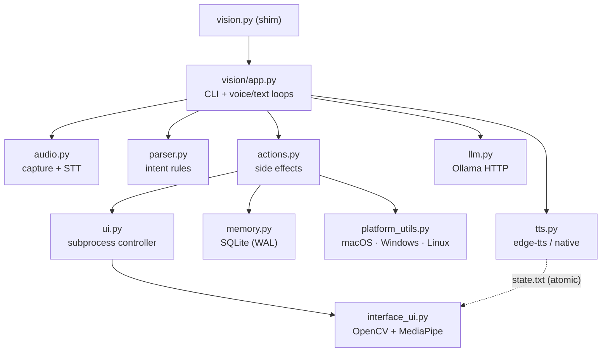

# Vision

**A cross-platform voice assistant with a holographic interface.** Double-clap or say “Hey Vision” and a reactive OpenCV hologram opens; speak a command and it runs.

What sets it apart: free-form questions go to a **local Ollama model**, speech recognition falls back to **offline Vosk**, and the hologram reacts to **hand gestures** — no cloud API keys and no telemetry.

[](https://github.com/helloworldpsys/VISION-1.2/actions/workflows/ci.yml)
[](#quick-start)
[](LICENSE)
[](#platform-support)
[](#development)

<p align="center">
  
</p>

<!-- TODO: record a 10-second demo GIF showing double-clap → hologram → voice command -->

## Features

| Feature | What it does |
|---|---|
| Double-clap activation | Two claps 0.1–0.8 s apart open the interface without touching the keyboard. |
| Wake phrase | “Hey Vision” (plus configurable variants) brings the assistant back from idle. |
| Holographic UI | Animated OpenCV hologram: blue when idle, red while Vision speaks. |
| Hand gestures | Optional MediaPipe tracking: one hand rotates the hologram, a two-hand pinch zooms. |
| English / Hindi / Hinglish | The rule-based parser understands all three; unmatched text goes to the LLM. |
| Local Ollama chat | Answers free-form questions through your own Ollama model. |
| Offline Vosk STT | Optional local recognizer when Google’s free service is unavailable. |
| SQLite memory | Names, notes and conversation history; one-time import of a Vision 1.2 `memory.json`. |
| macOS / Windows / Linux | One platform adapter per OS; no macOS-only command paths remain. |
| Audio fallback chain | PyAudio → sounddevice → typed commands instead of a crash. |

## Quick start

Python **3.10–3.12** is required (MediaPipe does not support 3.13+). A microphone and camera are optional — Vision degrades to typing and mouse control.

**macOS / Linux**

```bash
git clone https://github.com/helloworldpsys/VISION-1.2.git
cd VISION-1.2
./setup.sh
source .venv/bin/activate
python -m vision --setup
python -m vision --doctor
python -m vision
```

**Windows (PowerShell)**

```powershell
git clone https://github.com/helloworldpsys/VISION-1.2.git
cd VISION-1.2
powershell -ExecutionPolicy Bypass -File .\setup.ps1
Set-ExecutionPolicy -Scope Process -ExecutionPolicy Bypass
.\.venv\Scripts\Activate.ps1
python -m vision --setup
python -m vision --doctor
python -m vision
```

`--setup` writes a minimal `.env` and checks Ollama; `--doctor` prints a pass/fail line for microphone, camera, screenshots, volume, Ollama and the Vosk model (✅/❌ where the console supports UTF-8). Installing from a fork? Replace the clone URL. Existing scripts using `python vision.py` keep working — it is a compatibility shim around `python -m vision`.

## Example commands

| Say | What happens |
|---|---|
| “Open YouTube” / “youtube kholo” | opens YouTube |
| “Play Believer” / “believer gana sunao” | opens YouTube results |
| “Search Python tutorials on Google” | Google search |
| “Take a screenshot” | saves it to the data directory and opens it |
| “Take a photo” / “selfie” | saves a webcam frame |
| “Create a folder named projects” | creates it on the Desktop |
| “Volume 40” / “increase volume” / “mute” | controls system volume |
| “Battery” | reads battery status |
| “My name is Alex” / “What is my name” | memory |
| “Remember that my exam is on Friday” | saves a note |
| “Close interface” / “Open interface” | controls the UI window |
| “Go to sleep” | stops listening until “Hey Vision” |
| “Stop Vision” | shuts down cleanly |

Anything not matched is answered by the local Ollama model, with your saved name and notes in the system prompt.

## Configuration

Settings come from the environment, optionally loaded from `.env`. Both `VISION_`-prefixed and legacy un-prefixed names work (`VISION_OLLAMA_MODEL` or `OLLAMA_MODEL`). See [`.env.example`](.env.example) for a commented template.

| Key | Default | Meaning | Valid range |
|---|---|---|---|
| `ASSISTANT_NAME` | `Vision` | Name Vision uses for itself | any text |
| `CREATOR_NAME` | `Taha` | Name Vision credits as creator | any text |
| `OLLAMA_MODEL` | `llama3` | Local model for chat | a pulled model |
| `OLLAMA_HOST` | `http://127.0.0.1:11434` | Ollama endpoint | http(s) URL |
| `OLLAMA_TIMEOUT` | `60` | Request timeout (s) | > 0 |
| `OLLAMA_RETRIES` | `2` | Retries after a failed request | ≥ 0 |
| `TTS_ENGINE` | `edge` | Voice engine | `edge`, `native`, `none` |
| `EDGE_VOICE` | `en-US-ChristopherNeural` | edge-tts voice id | a valid edge-tts voice |
| `EDGE_RATE` | `-12%` | edge-tts speaking rate | edge-tts rate string |
| `EDGE_PITCH` | `-18Hz` | edge-tts pitch | edge-tts pitch string |
| `EDGE_VOLUME` | `+50%` | edge-tts volume | edge-tts volume string |
| `PLAY_VOLUME` | `2.5` | Playback gain | 0–4 (macOS), 0–1 (ffplay) |
| `SOX_EFFECT` | `true` | Metallic “Ultron” voice effect | `true` / `false` |
| `NATIVE_VOICE` | — | OS voice name | any installed voice |
| `NATIVE_RATE` | `150` | Native voice rate (words/min) | 80–450 on Linux, mapped on Windows |
| `STT_ENGINE` | `auto` | Recognition engine | `auto`, `google`, `vosk`, `text` |
| `STT_LANGUAGE` | `en-IN` | Google STT language | BCP-47 code |
| `PREFER_OFFLINE_STT` | `false` | Try Vosk before Google | `true` / `false` |
| `VOSK_MODEL_PATH` | — | Extracted Vosk model directory | existing directory |
| `MICROPHONE_ENABLED` | `true` | Set to false for typed-only mode | `true` / `false` |
| `MICROPHONE_DEVICE` | — | Input device index | ≥ 0, empty = default |
| `CALIBRATION_INTERVAL` | `120` | Ambient-noise recalibration (s) | ≥ 10 |
| `WAKE_LISTEN_TIMEOUT` | `4` | Wake-word listen window (s) | ≥ 1 |
| `WAKE_PHRASE_TIME` | `3` | Max wake phrase length (s) | ≥ 1 |
| `COMMAND_LISTEN_TIMEOUT` | `4` | Command listen window (s) | ≥ 1 |
| `COMMAND_PHRASE_TIME` | `8` | Max command length (s) | ≥ 1 |
| `MAX_AUDIO_FAILURES` | `3` | Capture errors before typed mode | ≥ 1 |
| `CLAP_ENABLED` | `true` | Double-clap activation | `true` / `false` |
| `CLAP_THRESHOLD` | `2000` | Clap RMS threshold | ~1000–4000 |
| `CLAP_MIN_INTERVAL` | `0.1` | Minimum gap between claps (s) | < `CLAP_MAX_INTERVAL` |
| `CLAP_MAX_INTERVAL` | `0.8` | Maximum gap between claps (s) | > `CLAP_MIN_INTERVAL` |
| `CLAP_DEBOUNCE` | `0.05` | Ignore repeat peaks (s) | ≥ 0 |
| `AUDIO_CHUNK` | `1024` | Frames per clap-detector block | > 0 |
| `AUDIO_RATE` | `44100` | Clap-detector sample rate (Hz) | 8000–48000 |
| `AUDIO_CHANNELS` | `1` | Clap-detector channels | `1` or `2` |
| `INTERFACE_ARGS` | — | Extra UI flags | `--sd` (720p) or `--hd` (1080p) |
| `INTERFACE_TIMEOUT` | `10` | Wait for the UI window (s) | > 0 |
| `WAKE_PHRASES` | `hey vision, …` | Comma-separated wake phrases | lowercase phrases |
| `DATA_DIR` | OS user-data dir | Memory, logs and captures | writable path |
| `LOG_DIR` | `<DATA_DIR>/logs` | Rotating log directory | writable path |
| `MEMORY_DB` | `<DATA_DIR>/memory.db` | SQLite database | writable path |
| `STATE_FILE` | `<DATA_DIR>/state.txt` | UI speaking-state file | writable path |
| `SCREENSHOT_DIR` | `<DATA_DIR>/screenshots` | Screenshot output | writable path |
| `PHOTO_DIR` | `<DATA_DIR>/photos` | Webcam photo output | writable path |
| `LEGACY_MEMORY_JSON` | `./memory.json` | Vision 1.2 memory to import once | path to JSON |
| `LOG_LEVEL` | `INFO` | Log verbosity | `DEBUG`, `INFO`, `WARNING`, `ERROR` |
| `LOG_MAX_BYTES` | `1000000` | Rotate after this size | > 0 |
| `LOG_BACKUPS` | `5` | Rotated files to keep | ≥ 0 |

Data lives in `%LOCALAPPDATA%\Vision` (Windows), `~/Library/Application Support/Vision` (macOS) or `${XDG_DATA_HOME:-~/.local/share}/vision` (Linux). An existing `memory.json` is imported once and renamed `memory.json.migrated`.

## Architecture

`vision/app.py` wires the voice/text loop to one module per concern. Parsing is pure and offline-safe; `actions.py` performs side effects through the platform adapter, SQLite memory and the UI controller. The OpenCV hologram runs in a **separate process** so a camera or MediaPipe failure can never freeze speech, and the only cross-process contract is an atomic `state.txt`.



See [docs/ARCHITECTURE.md](docs/ARCHITECTURE.md) for the process/thread model, SQLite schema and failure-handling matrix.

## Platform support

| OS | Status | Native tools used |
|---|---|---|
| macOS | ✅ | `say`, `afplay`, `open`, `osascript` (volume), `screencapture` |
| Windows | ✅ | SAPI via PowerShell, `winsound`/`ffplay`, `start`, pycaw (volume), .NET screen capture |
| Linux | ✅ | `espeak-ng`/`spd-say`, `paplay`/`ffplay`, `xdg-open`, `pactl`/`amixer`, `gnome-screenshot`/`scrot` |

## Troubleshooting

| Problem | Fix |
|---|---|
| `PyAudio` will not install | Install PortAudio first (`brew install portaudio`, `sudo apt install portaudio19-dev`). Vision falls back to sounddevice, then typed mode. |
| No microphone found | Grant microphone permission to your terminal, close Zoom/Teams, run `python -m vision --doctor`, or use `--text`. |
| Audio degraded to typed mode | No capture backend opened. Run `--doctor`; set `MICROPHONE_DEVICE` to the right index, or keep using typed commands. |
| Clap does not trigger | Lower `CLAP_THRESHOLD` (e.g. 1200) or disable `CLAP_ENABLED` and use the wake phrase. |
| Camera not found | Close other camera apps, grant camera permission, restart the terminal. Hand tracking is optional. |
| Hand model download fails | Download `hand_landmarker.task` manually into the cache directory printed by the error. |
| Vosk model not found | `VOSK_MODEL_PATH` must point at the extracted model folder (the one containing `am/` and `conf/`), not the zip. |
| Ollama not running | Start `ollama serve`; confirm with `curl http://127.0.0.1:11434/api/tags`. |
| “AI is not responding” | `ollama list`; pull the configured model, or fix `OLLAMA_HOST`/`OLLAMA_MODEL`. |
| Voice is robotic or offline | edge-tts needs internet; it falls back to the native voice. Set `TTS_ENGINE=native` to force offline. |
| Windows volume does nothing | `pip install "pycaw==20260927"` or put `nircmd.exe` on `PATH`. |
| Linux volume/screenshots fail | Install `pulseaudio-utils`/`alsa-utils` and a screenshot tool. |
| UI window is black or missing | Use a desktop session (not SSH), install `opencv-python`, and try `python -m vision --test-interface`. |
| `--doctor` reports a failure | Each failure prints a `fix:` line; a required failure (Python or Ollama) exits non-zero. |

## Development

```bash
python -m venv .venv
source .venv/bin/activate          # Windows: .\.venv\Scripts\Activate.ps1
pip install -r requirements-dev.txt
pytest -q                          # 142 tests, no hardware required
ruff check .
black --check .
python -m build                    # sdist + wheel in dist/
```

The suite injects subprocess runners, `shutil.which`, URL openers and hardware probes, so it runs on CI without a microphone, camera or network. CI lives in [`.github/workflows/ci.yml`](.github/workflows/ci.yml). Read [CONTRIBUTING.md](CONTRIBUTING.md) before opening a pull request.

## Roadmap

- Offline wake-word model, so “Hey Vision” no longer needs the cloud recognizer.
- A plugin API for third-party commands instead of editing `parser.py` and `actions.py`.
- Native packaging (`.app` / `.exe`) with a bundled Python runtime.
- Streaming Ollama responses to cut time-to-first-word.

## License and credits

MIT — see [LICENSE](LICENSE). Vision 1.2 was created by Taha Shaikh ([helloworldpsys](https://github.com/helloworldpsys)); Vision 2.0 keeps the original command set and UI while hardening the codebase for macOS, Windows and Linux.
