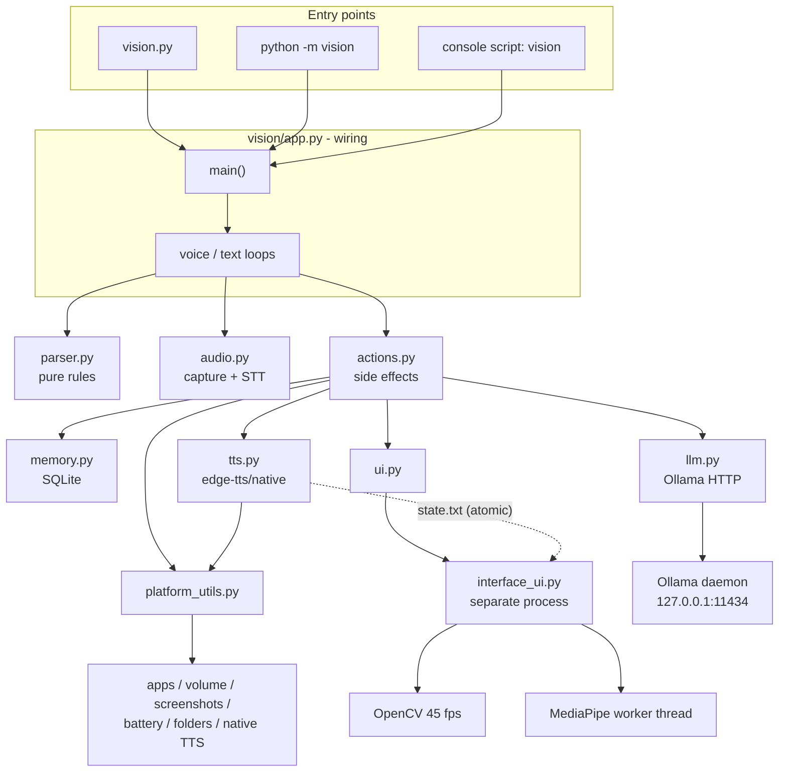
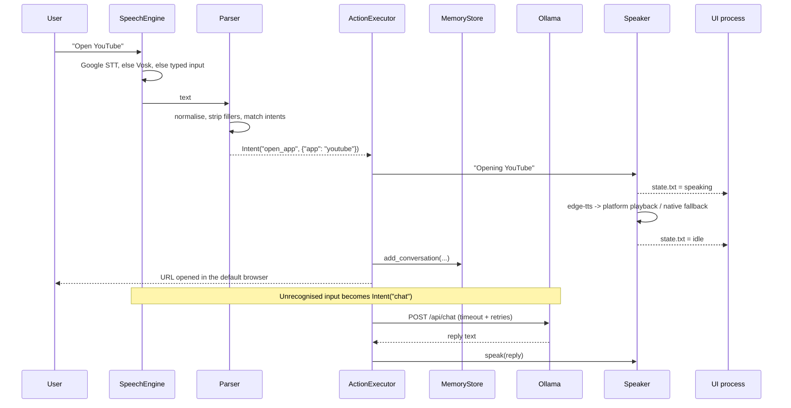

# Architecture

This document describes Vision 2.0’s runtime structure, process model, data
model and failure handling. For setup and usage see [README](../README.md).

## Component map



## Process and thread model

| Context | Owns | Notes |
|---|---|---|
| Main process, main thread | voice/text loop, command execution, LLM call, TTS | Blocking calls are acceptable here; the UI is elsewhere. |
| Main process, clap thread | double-clap detection | Daemon thread; stopped after activation or shutdown. |
| UI child process, main thread | OpenCV HighGUI loop | Required by macOS; renders at ~45 fps. |
| UI child process, camera thread | frame capture + MediaPipe | Pushes results to the renderer through a lock. |

The main process and UI communicate through exactly one contract: the
`state.txt` file written atomically by `vision/state.py` and polled every 80 ms
by `vision/interface_ui.py`. Values are `speaking` / `idle`, and a state older
than 120 seconds is ignored so a crashed assistant cannot leave the hologram
red.

Starting the UI as a child process means:

- a camera/MediaPipe failure degrades to mouse control without stopping speech;
- the voice loop never blocks on `cv2.waitKey`;
- the UI can be killed independently (`InterfaceController.close`).

## Command sequence



## Data model (SQLite)

`memory.db` is opened in WAL mode with a 5 s busy timeout and a process-wide
re-entrant lock. WAL allows concurrent readers; the lock serialises writes
through a single connection, which is sufficient for a desktop assistant.

```sql
CREATE TABLE profile (
    key   TEXT PRIMARY KEY,   -- currently only 'name'
    value TEXT NOT NULL
);

CREATE TABLE notes (
    id         INTEGER PRIMARY KEY AUTOINCREMENT,
    text       TEXT NOT NULL,
    created_at TEXT NOT NULL  -- ISO-8601 UTC
);

CREATE TABLE conversations (
    id             INTEGER PRIMARY KEY AUTOINCREMENT,
    user_text      TEXT NOT NULL,
    assistant_text TEXT NOT NULL,
    created_at     TEXT NOT NULL
);
```

The first start imports a legacy Vision 1.2 `memory.json` (name, notes, last 10
conversations) and renames it to `memory.json.migrated`. Existing databases are
never overwritten by the import.

## Failure handling matrix

| Failure | Detection | Fallback | User-visible result |
|---|---|---|---|
| PyAudio missing/unusable | backend constructor raises | `sounddevice` | voice still works |
| No capture backend | both constructors fail | typed commands | prompt in terminal |
| Repeated capture errors | `MAX_AUDIO_FAILURES` | typed commands | switches mid-session |
| Google STT offline | `RequestError` | Vosk model if configured | offline recognition |
| Vosk model missing | path check | Google | online recognition |
| edge-tts offline/not installed | import or playback failure | native `say`/SAPI/`espeak-ng` | spoken reply |
| Windows MP3 playback | `ffmpeg` missing | native voice | spoken reply |
| Ollama down | `URLError` after retries | spoken apology | no traceback |
| Memory DB locked | SQLite error | log + in-memory store | session continues |
| Volume tool missing | `which` checks | log + spoken hint | command reports failure |
| Screenshot tool missing | `which` checks | spoken hint | command reports failure |
| Camera missing | `VideoCapture.isOpened()` | hand tracking off, mouse works | UI still usable |
| UI crash | child process exits | voice loop unaffected | reopen via command |
| Stale speaking state | mtime > 120 s | treated as idle | hologram returns to blue |

## Security boundaries

- **No shell:** `platform_utils` passes argv lists to `subprocess.run` with
  `shell=False` and a timeout. The Windows `start` target is validated against a
  safe character set.
- **Filesystem:** folder names go through `safe_filename` (path separators,
  Windows-invalid characters, reserved device names, length cap).
- **PowerShell:** single quotes are doubled before interpolation into SAPI and
  screenshot scripts.
- **Configuration:** secrets belong in `.env` (git-ignored); no keys are stored
  in code. Memory, logs and captures stay in the per-user data directory.
- **Cloud exposure:** Google STT receives microphone audio; edge-tts receives
  reply text. Vosk + `TTS_ENGINE=native` keeps both local.

## Extension points

| Goal | File | Contract |
|---|---|---|
| New voice command | `parser.py` + `actions.py` | return `Intent`, add `_do_<name>` |
| New OS backend | `platform_utils.py` | subclass `PlatformAdapter` |
| New STT engine | `audio.py` | add a recogniser with the same return contract |
| New TTS engine | `tts.py` | return `True` from a `_speak_*` method |
| New persistence | `memory.py` | keep the `MemoryStore` public methods |
| New UI | `ui.py` + `interface_ui.py` | only the state file is shared |

Tests inject the subprocess runner, `shutil.which`, `urlopen` and the URL opener,
so platform and network code can be verified without touching real hardware.
